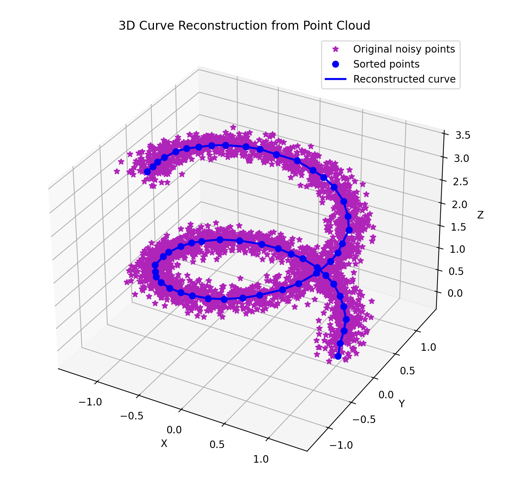

# 3D Point Cloud Curve Extraction

Extracts smooth curves from noisy 3D point clouds using PCA-based thinning and directional sorting.

Heavily based on "Curve Reconstruction from Unorganized Points" by In-Kwon Lee


## Usage

```python
from curve_extraction import thin_line, sort_points
import numpy as np

# Your Nx3 array of points in [x,y,z] form
points = np.array([[x1, y1, z1], [x2, y2, z2], ...])

# 1. Thin the point cloud
thinned_points, regression_lines = thin_line(points)

# 2. Sort points into a curve
sorted_points = sort_points(thinned_points, regression_lines)
```


This is not currently published as a library so for now just copy `curve_extraction.py` into your project and use as follows. If you do, I suggest removing the timing and print statements.


## Demo

Run the demo to see it work on a noisy spiral:

```bash
uv run visualization.py
```



## Parameters

**thin_line**
- `point_cloud_thickness` - radius for selecting points during PCA (default: 0.53)

**sort_points**
- `sorted_point_distance` - radius for finding adjacent points when ordering (default: 0.2)

## Files

- `curve_extraction.py` - core algorithm
- `visualization.py` - demo and plotting functions